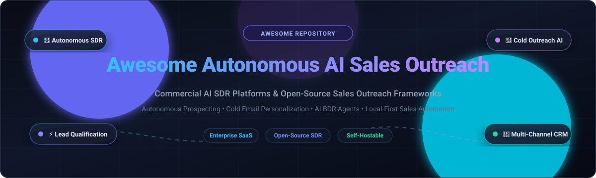

# Awesome-Autonomous-AI-Sales-Outreach

# Awesome-Autonomous-AI-Sales-Outreach 🤖 📧

  

  

  

  

  

  

  

---

## 🌟 Top Autonomous AI Sales Outreach Ecosystem

**Curated List of Commercial AI SDR Platforms & Open-Source Sales Outreach Frameworks**  

*Focused on Autonomous Prospecting, Cold Email, AI Personalization, Lead Research, Multi-Channel Sequences & Self-Hosted Sales Agents*

**Last updated: October 2026** 📅

---

### 📌 Overview & SEO Summary

Welcome to the ultimate curated directory of **autonomous AI sales outreach platforms**, **open-source sales automation frameworks**, and **AI-powered SDR tools**. Whether you are looking for enterprise-grade commercial solutions (such as *Salesforce Hunter*, *Regie.ai*, and *Artisan*), or self-hostable open-source alternatives (like *OpenCloser*, *ColdScout*, and *Warmbly*), this list covers category leaders, autonomous prospecting, and privacy-respecting sales automation.

**Key Market Context:**

- **Salesforce Hunter** is the **first agent built on Salesforce's long-horizon runtime** — it doesn't just plan the work, it **carries it out over weeks and months**, preserving memory across sessions and accepting mid-flight steering from human reps . **Currently in pilot with general availability planned for November 2026** .

- **Agentforce SDR** can now **automate outreach to contacts and person accounts in addition to leads**, and support **cross-sell, upgrade, and other sales programs** aimed at existing customers .

- **11x.ai** is the **fully autonomous outbound AI SDR** designed to replace human SDR workflows end-to-end — but **expensive relative to alternatives** and **still relies on cold data and list quality** .

- **Artisan's Ava** provides an **all-in-one outbound AI SDR with built-in data, sequencing, and personalization workflows** — strong personalization system, multi-channel outreach, clean product experience .

- **AiSDR** focuses on **simplifying adoption with multi-channel approach and faster setup** — easy onboarding and clear pricing model, but **less advanced than category leaders and limited depth in customization** .

- **Regie.ai** focuses on **improving outbound messaging and sequencing through AI** — strong copy generation and improved personalization quality, but **limited autonomy** and **does not handle the full SDR workflow** .

- **Instantly.ai and Smartlead.ai** are **both pushing into autonomous prospecting** — Instantly added **Signals in SuperSearch (5.8M new signals per week matched against 450M contacts)** and an **AI Sales Agent**, while Smartlead ships **SmartProspect**, **SmartDelivery**, and **SmartAgents** .

- **Warmbly** is the **largest open-source B2B cold outreach and email warmup service** — runs campaigns from mailboxes you own, warms them so they keep landing in inbox, with AI-native agentic workflows .

- **OpenCloser** is the **most complete open-source AI SDR & sales platform** — AI Sales Strategist (SPIN & Challenger frameworks), AI Lead Researcher, AI Caller (real-time voice with Twilio), AI Sales Coach (objection sparring), and AI Sales Manager (post-call debrief) — all running locally with zero cloud dependency .

- **ColdScout** is an **autonomous AI-powered B2B lead generation SaaS** — discovers businesses via Google Places, qualifies with Groq Llama 3, and sends hyper-personalized cold email campaigns .

---

## 📑 Table of Contents

- [🏢 SaaS & Commercial Platforms](#-saas--commercial-platforms)

- [🔓 Open-Source GitHub Projects](#-open-source-github-projects)

- [🛠️ How to Contribute](#%EF%B8%8F-how-to-contribute)

- [📊 Star History](#-star-history)

- [🤝 Support & Sponsorship](#-support--sponsorship)

- [⚠️ Disclaimer](#%EF%B8%8F-disclaimer)

---

## 🏢 SaaS / Commercial Platforms

The autonomous AI sales outreach market spans **CRM-native outbound agents** (Salesforce Hunter) that integrate **deeply with Sales Cloud and work over weeks with persistent memory**, **AI-native SDR platforms** (11x.ai, Artisan, AiSDR) that **autonomously prospect, personalize, and book meetings**, and **sales engagement platforms** (Regie.ai, Reply.io, Instantly) that **augment human reps with AI-powered sequencing and deliverability**. **Salesforce Hunter** is **included in Max Edition ($550/user/month)** . **AiSDR** publishes pricing at **$250–$2,500/month** based on contacts . **Regie.ai** starts at **$41/month** (Pro, annual) with **5,000 credits** .

| SaaS / Commercial Platform | Company / Owner | Size (Valuation / Revenue) | Standard Edition Starting Price | Free Tier / Free Trial Limits | Description |
| :--- | :--- | :--- | :--- | :--- | :--- |
| **[Salesforce Hunter](https://www.salesforce.com/sales/ai-sales-agent/outbound/)** ☁️ | Salesforce | ~$250B Market Cap (~$38B ARR) | **$550/user/month** (Included in Sales Cloud Max Edition) | **Pilot access via account team; GA planned Nov 2026 (No standalone self-serve free trial)** | **First long-horizon outbound sales agent** — **Works a sales pipeline from research to outreach, collaborating with sellers over weeks and months** . **Researches and prioritizes accounts, drafts and sends outreach, learns from how top sellers win** . **Persistent memory across sessions, mid-flight steering from human reps** . **Pilot customer Perk reported 60% of pipeline built by Hunter** (vendor-selected) . |
| **[Agentforce SDR](https://help.salesforce.com/s/articleView?id=release-notes.rn_sales_agents_sdr.htm)** ☁️ | Salesforce | ~$250B Market Cap (~$38B ARR) | **$125/user/month** (Add-on to Enterprise/Unlimited; included in Max) | **30-day guided trial via Trailhead Playgrounds ("Build an Agent to Nurture Leads"); standard Sales Cloud trials exclude SDR agent** | **Inbound SDR agent** — **Sends initial emails, nudges, and responses to interested replies** . **Now reaches contacts and person accounts in addition to leads** . **Supports cross-sell and upgrade programs for existing customers** . **Up to 5 separate agents customized per customer group** . **Generates in French, Italian, German, Spanish, Japanese, and Portuguese** . |
| **[Conversica](https://www.conversica.com/)** 🟢 | Conversica | ~$300M Valuation (~$24.6M ARR, $132M funding) | **$2,999/month** (Annual subscription baseline for enterprise AI assistant) | **No self-serve free trial; live interactive vendor demo only** | **AI sales assistant for lead engagement** — **AnswersIQ leverages RAG for accurate, consistent, real-time responses across SMS and email** . **Fact collection from websites and uploaded documents** . **Automates lead follow-ups and re-engages prospects** . |
| **[11x.ai](https://www.11x.ai/)** 🎯 | 11x | ~$300M–$500M Valuation ($76M funding) | **$3,750/month** (Growth plan, billed annually at $45,000/yr) | **No free trial; live sales-led demo and custom enterprise procurement only** | **Fully autonomous outbound AI SDR** — **Handles prospecting, outreach, follow-ups, and booking across channels** . **Julian is AI phone agent responding in seconds** . **High level of automation across the outbound funnel** . **Expensive relative to alternatives; still relies on cold data and list quality** . |
| **[Regie.ai](https://www.regie.ai/)** ⚙️ | Regie.ai | ~$150M–$200M Valuation (~$10M ARR, $65M funding) | **$41/month** (Pro plan, annual billing; $49/mo billed monthly, 5,000 credits/mo) | **Free plan: 250 one-time credits with Chrome extension and email analyzer** | **AI sales engagement platform** — **Orchestrates plays across channels with AI Agents doing the heavy lifting** . **Strong copy generation, improved personalization quality, quick campaign setup** . **Limited autonomy; does not handle full SDR workflow** . **Enterprise-tier custom quotes: $25,000–$100,000+ annual** . |
| **[Artisan (Ava)](https://www.artisan.co/)** 🏭 | Artisan | ~$100M Valuation ($46M funding) | **$250/month** (Intern plan, billed annually at $2,700/yr or $280/mo billed monthly) | **Free plan: 300 credits/month for contact discovery and personalization tests** | **All-in-one outbound AI SDR** — **Built-in data, sequencing, and personalization workflows** . **Strong personalization system, multi-channel outreach, clean product experience** . **Still dependent on outbound lists; requires setup and iteration** . **250M+ verified B2B contacts** . |
| **[Instantly.ai](https://instantly.ai/)** 📧 | Instantly | ~$40M ARR (Bootstrapped, ~$200M+ est. valuation) | **$37.60/month** (Growth plan, billed annually; $47/mo billed monthly) | **14-day free trial: 1,000 emails, 250 contact uploads, 100 enrichment credits (no credit card required)** | **Cold email infrastructure with autonomous prospecting** — **Signals in SuperSearch: 5.8M new signals per week matched against 450M contacts** . **AI Sales Agent runs prospecting end-to-end from a single URL** . **Automations with webhooks, Airtable, and Salesforce** . **Unlimited mailboxes at flat rate** . |
| **[Smartlead.ai](https://www.smartlead.ai/)** 🔷 | Smartlead | ~$14M ARR (Bootstrapped, ~$80M+ est. valuation) | **$33/month** (Basic plan, billed annually; $39/mo billed monthly) | **14-day free trial: 2,500 email sends, 1,250 active contacts, unlimited connected mailboxes (no credit card required)** | **Cold email infrastructure with autonomous agents** — **SmartProspect for B2B lead search inside the platform** . **SmartDelivery for inbox placement testing pre-send** . **SmartAgents for autonomous prospecting** . **Dedicated infrastructure (SmartInfra) at ~$39/server/month** . **Client Access for agency collaboration** . |
| **[Reply.io Jason AI](https://reply.io/)** ⚡ | Reply.io | ~$14.7M ARR ($400K funding) | **$49/user/month** (Outreach Email plan, annual) / **$500/month** (Autonomous Jason AI SDR Starter) | **14-day free trial: full access to sequence builder, email warm-up, and 200 B2B contact data credits (no credit card required)** | **Self-learning AI SDR** — **Jason 4.5 watches what you edit and turns repeated changes into AI Learnings applied automatically** . **Custom Playbook builds sales strategy from offer, ICP, and business context** . **LinkedIn Intent Signals** tracks prospects engaging with relevant content . **Calendly booking on autopilot** . |
| **[Lavender](https://www.lavender.ai/)** 💜 | Lavender | ~$10.8M ARR ($14.2M funding) | **$27/user/month** (Starter plan, billed annually; $29/mo billed monthly) / **$500/agent/month** (Ora AI Sales Agent) | **Free plan: 5 analyzed emails and 5 personalized emails per month; 7-day full free trial on paid plans (no credit card required)** | **AI sales email coach** — **Grades emails and gives tips to improve** . **Reply rates increase 2-3x when emails score 90 or above** . **Personalization Assistant brings prospect data directly to inbox** . **SOC 2 & GDPR certified** . |
| **[AiSDR](https://aisdr.com/)** 🚀 | AiSDR | ~$4.5M ARR ($3M funding) | **$250/month** (Solo plan, 200 AI-researched contacts/mo, $1.25/extra contact) | **Build-before-pay access: chat with AI agent Ami and create campaigns free (billing activates only upon live campaign launch; no contact sending trial)** | **Simplified outbound AI SDR** — **Easy onboarding, multi-channel execution, clear pricing model** . **Deeper Salesforce integration than bidirectional contact sync** — every email, reply, and meeting recorded on Contact and Account timelines . **AI account scoring against 1-4 custom criteria** . **Less advanced than category leaders; limited depth in customization** . **$1.25 per contact on Solo, $1 on Scale** . |
---

## 🔓 Open-Source GitHub Projects

*Sorted by GitHub_Stars_Count (Descending)* 🌟

- **[OpenCloser](https://github.com/issacops/opencloser)**   

  **Open-source AI SDR & AI sales platform**, MIT licensed. **The most complete open-source AI sales team** — **AI Sales Strategist generates ICP using SPIN & Challenger frameworks** . **AI Lead Researcher does autonomous lead hunting with scoring and qualification, full local-first CRM with Kanban pipeline** . **AI Caller (SDR) is a real-time AI voice agent** powered by Google Gemini (also supports OpenAI Realtime and ElevenLabs ConvAI) with **built-in Twilio phone lines, live transcription, sentiment analysis, objection detection, and power dialing** . **AI Sales Coach offers objection sparring training with 3 difficulty levels and 12 objection archetypes** . **AI Sales Manager does post-call debrief with auto-generated follow-up emails and call analytics** . **Runs fully in demo mode with no API key** . **Built with Tauri, React 19, Rust, and Gemini** . **Cost: Free vs $280–$1,000+/month per seat for SaaS alternatives** . 🚀

- **[Warmbly](https://github.com/warmbly/warmbly)**   

  **The largest open-source B2B cold outreach and email warmup service**, open-source. **Runs cold email campaigns from mailboxes you already own and warms them so they keep landing in the inbox** . **Opens, clicks, and replies land in a shared dashboard the moment they happen** . **AI-native — your team and its agents work in it together, live** . **Features: multi-step sequences with per-mailbox caps, unified inbox, CRM with pipelines and deals, warmup pool of monitored mailboxes (not throwaway accounts), deliverability management, visual reply playbooks with AI steps, HubSpot/Slack/Zapier integrations, realtime presence** . **Control plane (backend API, Postgres, Redis, event bus) + execution plane of interchangeable Go workers that send and sync mail** . **Self-hosting with no cloud account of any kind** — one command brings up the whole platform on local, open-source pieces . **Envelope encryption with local AES master key or AWS KMS** . 🛡️

- **[ColdScout](https://github.com/colddsam/coldscout)**   

  **Autonomous AI-powered B2B lead generation SaaS**, open-source. **Discovers local businesses via Google Places, qualifies them with Groq Llama 3, and sends hyper-personalized cold email campaigns** . **Pipeline stages: Google Places API → Playwright/BeautifulSoup scraping → Groq AI qualification → Groq AI email generation → Brevo SMTP sending** . **Each stage independently schedulable via jobs_config.json with hour/minute precision** . **Job Manager allows pausing, resuming, and manual triggering of any stage from dashboard** . **Security: strict CSP headers, sandboxed iframe, HTML validation with 500KB size cap** . **Built with FastAPI, React 19, PostgreSQL, Supabase Auth, and Razorpay billing** . 🎯

- **[simple-sales-gpt](https://github.com/BOFOII/simple-sales-gpt)**   

  **Modular Go package for building sales conversation agents**, MIT licensed. **One agent session per conversation** with shared knowledge base for products, promotions, and vector search . **Configurable LLM model — core package does not hardcode a model provider** . **Configurable vector store — Chroma, Milvus, Pinecone, or any LangChainGo-compatible store** . **Tool registry with named tools, descriptions, parameters, and handlers** . **Conversation stages and interest levels** . **Optional semantic enrichment before storing products or promotions in vectors** . **Step-based execution for reasoning, tool selection, tool execution, and final response generation** . **Uses LangChainGo for LLM, embedding, memory, and vector store integrations** . 🛠️

- **[ColdPost](https://github.com/Avika2211/ColdPost)**   

  **Lightweight email automation tool for cold outreach**, open-source. **Designed to simplify cold outreach for students and entrepreneurs** . **Upload recipient lists via CSV, personalize messages using {name} variables, attach files like resumes or pitch decks, and send customized emails in bulk through Gmail SMTP** . **Clean and intuitive web interface** . **Built with HTML, JavaScript, and Python (Flask)** . **A free and efficient alternative to expensive outreach platforms** . 📧

- **[AI Sales Agent (Dvbxtreme)](https://github.com/Dvbxtreme/ai-sales-agent)**   

  **Open-source AI-powered sales agent built with Next.js 15**, open-source. **Generates content, finds leads, and automates outreach — all running locally with Ollama (no API costs)** . **Features: AI Chatbot (local LLM), Content Generator (blog posts, tweets, LinkedIn posts, emails), Lead Finder (scrape potential customers from the web), Auto Outreach (generate personalized outreach emails), Admin Dashboard, Blog** . **Tech stack: Next.js 15 (App Router), Ollama, SQLite, JWT auth, Tailwind CSS** . **No API costs — runs entirely locally** . 🖥️

---

## 🛠️ How to Contribute

Contributions are welcome! Follow these steps to submit new autonomous AI sales outreach platforms or open-source sales automation software:

1. 🍴 **Fork** the repository.

2. 📝 **Add/edit** entries in `README.md` maintaining table/list structure and formatting.

3. 🔗 Include project title, official website/GitHub link, exact Stars_Count, license, and brief description.

4. 🚀 Submit a **Pull Request** with a descriptive summary of your changes.

---

## 📊 Star History

---

## 🤝 Support & Sponsorship

If you find this autonomous AI sales outreach repository useful, please consider supporting the project:

- ⭐ **Star** this repository to increase visibility!

- 🔀 **Fork** and share with fellow sales leaders, RevOps professionals, and open-source advocates.

- ☕ **Sponsor & Buy Me a Coffee**: Support ongoing open-source curation via the [GitHub Sponsor Dashboard](https://github.com/sponsors/ishandutta2007).

---

## ⚠️ Disclaimer

- This is a **community-curated** list — not exhaustive and not an endorsement. ℹ️

- **Salesforce Hunter is in pilot now with GA planned for November 2026** — **pricing was conspicuously absent from the announcement** . **Max Edition ($550/user/month) bundles Hunter and a range of other Sales Cloud products** . **The pre-acquisition Qualified pattern (list ~$68K, TCO $95K–$165K+ with stack and services) is the most honest anchor for what a serious deployment will cost** .

- **Pure AI SDR tools deliver 1–3% reply rates at $750–$5,000+/month, while hybrid AI-assist stacks (Clay + Lemlist/Smartlead) deliver 4–8% reply rates at $150–$400/month** — **the unit economics of hybrid AI-assist beat pure AI SDR by 3 to 5x on cost-per-qualified-meeting** .

- **11x.ai and Artisan do not publish pricing** — **both require demo and sales engagement** . **AiSDR publishes pricing at $250–$2,500/month based on contacts** . **Regie.ai starts at $41/month with 5,000 credits** .

- **Open-source sales outreach tools are not turnkey** — **OpenCloser requires Node.js, Rust, and Tauri prerequisites** . **Warmbly requires Docker, Go 1.25, and pnpm** . **ColdScout requires Python 3.11+, PostgreSQL, and multiple API keys** . **Always validate outreach quality, deliverability, and CRM data hygiene with a proof-of-concept** before production deployment. 📧

---

  <b>Made with ❤️ for sales leaders, RevOps professionals, and open-source AI sales outreach advocates.</b>

